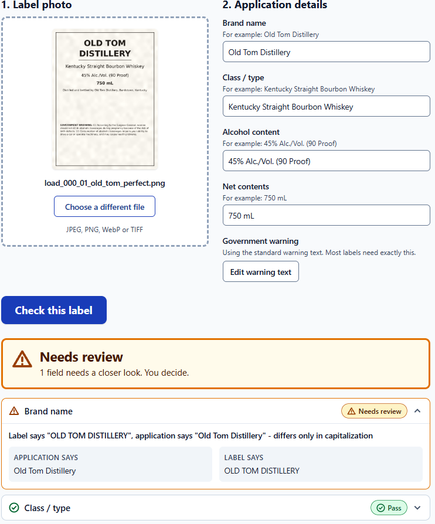
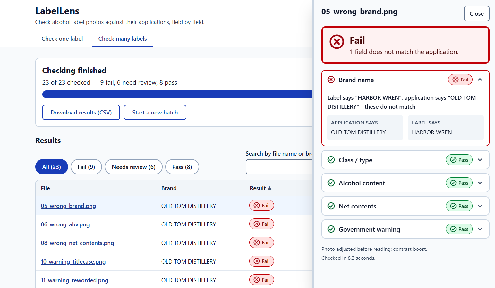

# LabelLens

AI-assisted label verification for alcohol compliance review. Upload a label image, enter the
application data, and LabelLens tells you field by field whether the label matches, in about
five seconds. It also handles batches of hundreds of labels.

**Live demo:** [labellens-7rxl.onrender.com](https://labellens-7rxl.onrender.com/)
**Repository:** [github.com/rakeebh7233/LabelLens](https://github.com/rakeebh7233/LabelLens)





> Prototype for evaluation. Standalone: no COLA integration, no authentication, no data
> retained after processing. See [Assumptions](#assumptions) and [Limitations](#known-limitations).

---

## Try it in 60 seconds

1. Open the live demo (or run locally, below).
2. Go to **Check one label**, drop in `samples/labels/01_old_tom_perfect.png`.
3. Click **Check this label**. Every field should come back green.
4. Now try `05_warning_titlecase.png` to see the warning rule fail, and `02_stones_throw_case.png`
   to see a "needs review" result.
5. Go to **Check many labels**, upload everything in `samples/labels/` plus
   `samples/applications.csv`.

## What it checks

| Field              | How it is compared                                                                                                   | Possible results     |
| ------------------ | -------------------------------------------------------------------------------------------------------------------- | -------------------- |
| Brand name         | Normalized text match, fuzzy fallback                                                                                | Pass / Review / Fail |
| Class/type         | Normalized text match, fuzzy fallback                                                                                | Pass / Review / Fail |
| Alcohol content    | Parsed numerically; ABV and proof are interchangeable                                                                | Pass / Fail          |
| Net contents       | Parsed and converted to mL                                                                                           | Pass / Review / Fail |
| Government warning | Exact wording; "GOVERNMENT WARNING:" must be uppercase; bold checked by stroke width (not bold or unclear -> review) | Pass / Review / Fail |

**Three results, not two.** *Pass* means it matches. *Needs review* means it is probably fine but a
person should decide (for example `STONE'S THROW` vs `Stone's Throw`). *Fail* means a clear
mismatch. The overall label result is the worst field result. Every non-pass result includes a
plain-English reason.

---

## Quick start

### Option A: Docker (recommended)

```bash
docker compose up --build
# open http://localhost:8000
```

### Option B: Local development

Requirements: Python 3.11+, Node 20+, Tesseract OCR installed on the system.
Ubuntu 22.04 / WSL ships Python 3.10 and Node 12; `uv python install 3.12` and
`nvm install 20` get you current versions without sudo, and `make install` picks up
`python3.12` automatically.

```bash
# Tesseract
brew install tesseract              # macOS
sudo apt install tesseract-ocr      # Debian/Ubuntu

# Backend
cd backend
python -m venv .venv
source .venv/bin/activate           # Windows: .venv\Scripts\activate
pip install -r requirements.txt
uvicorn app.main:app --reload       # http://localhost:8000

# Frontend (new terminal)
cd frontend
npm install
npm run dev                         # http://localhost:5173 (proxies /api to the backend)
```

### Tests and sample data

```bash
cd backend && pytest                # backend unit + API + sample tests
cd frontend && npm test             # component tests
python scripts/make_samples.py      # regenerate samples/labels and samples/applications.csv
```

### Deploying to Render (free tier)

The repo includes `render.yaml`, a Render Blueprint for one free web service built from the
`Dockerfile`.

1. Push the repo to GitHub.
2. Sign up at [render.com](https://render.com) (the free plan needs no card).
3. **New -> Blueprint**, pick the repo, and confirm. Render builds the image (a few minutes)
   and gives you a `https://<name>.onrender.com` URL. Pushes to the default branch redeploy.
4. Check `https://<name>.onrender.com/api/health` returns `"tesseract_available": true`. The
   startup log also prints the CPUs the app sees and the result of an OCR self-test.

**What to expect on the free tier:**

- **It sleeps** after 15 minutes without traffic and takes about a minute to wake. Open the
  URL a minute before a demo. Sleeping (or any redeploy) also forgets batch jobs, which live
  in memory.
- **It is at or over the 5-second target.** Measured on the live demo (October 2026): a clean
  label that needs one OCR pass takes **about 4.5 s** (5.2 s round trip); a label that needs
  the second, heavier pass (any mismatch, glare, rotation) takes **8-9.5 s**. One OCR pass
  costs about 4 s on the free CPU. All results matched the local ones. Every result shows
  its time, and `timings_ms` in the API response breaks it down.
- **Batches are capped at 200 MB of photos** (`LABELLENS_MAX_BATCH_MB`) to fit in 512 MB:
  about 300 of the sample labels, or about 50 full-size phone photos. At 0.1 CPU a batch
  checks about 8 labels a minute.

**Sizing for the 5-second target:** the app needs about 0.75 CPU-seconds per label, so any
instance with half a CPU or more meets it (1.5 s median at 0.5 CPU, 0.8 s at 1 CPU; see
below). Keep a single instance and a single process either way: batch jobs live in memory.

The hosted URL is for evaluating the prototype. An agency deployment would run the same
Docker image inside the agency network; it makes no outbound calls.

---

## How it works

```
image -> resize/preprocess -> OCR (once) -> compare each field -> LabelResult
                                   |
                         timings_ms returned for every request
```


1. **Preprocess** (OpenCV): cap image size, grayscale, boost contrast. If OCR confidence is low,
   also deskew and reduce glare.
2. **OCR once** (Tesseract, runs locally) and reuse the result for every field.
3. **Compare** each field with rules specific to that field (see table above).
4. **Report** a result per field with the expected value, the value found, and a reason.

Batches run through a bounded worker pool. Each label is isolated, so one unreadable file never
stops the batch. Results appear as they finish and can be exported as CSV.

## API

| Method | Path                               | Purpose                                                    |
| ------ | ---------------------------------- | ---------------------------------------------------------- |
| POST   | `/api/verify`                    | One image + application fields -> `LabelResult`          |
| POST   | `/api/batch`                     | Images + `manifest.csv` -> `{job_id}`                  |
| GET    | `/api/batch/{job_id}`            | Progress and results so far                                |
| DELETE | `/api/batch/{job_id}`            | Stop a batch; finished results are kept                    |
| GET    | `/api/batch/{job_id}/export.csv` | Download results                                           |
| GET    | `/api/health`                    | Health check (also reports whether Tesseract is available) |

Interactive docs: `/docs` (FastAPI Swagger UI).

**Batch manifest columns:** `filename, brand_name, class_type, alcohol_content, net_contents`
(optional: `government_warning`). Rows are matched to images by `filename`.

---

## How the stakeholder feedback shaped the design

| What we heard                                                                       | Decision                                                                                                                                                                    |
| ----------------------------------------------------------------------------------- | --------------------------------------------------------------------------------------------------------------------------------------------------------------------------- |
| "If we can't get results in about 5 seconds, nobody's going to use it." (Sarah)     | Local OCR, one OCR pass per label, image downscaling, per-stage timings returned so the budget is measurable. <TODO: add your measured median/p95>                          |
| "Something my mother could figure out." (Sarah)                                     | One main action per page, large buttons, visible labels, plain-language messages, status shown with text and icons, not color alone.                                        |
| Batch uploads of 200-300 labels (Sarah)                                             | Batch page with CSV manifest, live progress, sortable table with fails first, CSV export.                                                                                   |
| Network blocks outbound domains; the previous vendor's ML endpoints failed (Marcus) | No cloud AI dependency. All OCR runs inside the app container.                                                                                                              |
| "You need judgment." STONE'S THROW vs Stone's Throw (Dave)                          | Three-state results. Case-only differences become *Needs review*, so the agent keeps the decision.                                                                        |
| Warning must be exact, uppercase and bold (Jenny)                                   | Word-for-word comparison against the canonical text; uppercase prefix enforced; bold checked by stroke width, with doubtful cases sent to review.                           |
| Bad angles, glare, poor lighting (Jenny)                                            | Conditional deskew and glare reduction when OCR confidence is low; very poor images produce *Needs review* with a hint to request a better photo instead of a false pass. |

## Tools and why

| Choice                  | Reason                                                   | Alternative considered                                                      |
| ----------------------- | -------------------------------------------------------- | --------------------------------------------------------------------------- |
| Python + FastAPI        | Strongest OCR/image ecosystem; async-friendly uploads    | Node backend (weaker OCR tooling)                                           |
| Tesseract (local)       | No outbound calls, fast, easy to containerize            | Cloud vision APIs (blocked by firewall, added latency); PaddleOCR (heavier) |
| OpenCV                  | Standard for deskew/contrast/glare work                  | Pillow only (not enough)                                                    |
| rapidfuzz               | Fast fuzzy matching                                      | difflib (slower, fewer scorers)                                             |
| React + Vite + Tailwind | Fast to build accessible, clear UI                       | Server-rendered templates                                                   |
| Docker                  | Tesseract is a system dependency; one reproducible image | Native buildpack                                                            |

[Detailed Decision Document](docs/DECISIONS.md)

---

## Assumptions

- Standalone prototype; no COLA integration or authentication.
- No sensitive data is stored. Uploads are processed in memory or temp storage and deleted after
  the request or batch job finishes. Batch jobs live in memory and expire after <TODO: TTL>.
- A production deployment would need document retention rules, PII handling, audit logging and
  federal compliance review. Out of scope here.
- Application data is entered by the user (single) or supplied in a CSV (batch).
- Warning text is compared against the standard statement in `backend/app/extract/warning.py`.
- Rules cover the common fields only. Beverage-specific rules (for example wine appellations or
  beer-specific exemptions) are not implemented.

## Known limitations

- **Bold detection** is a stroke-width heuristic, calibrated on synthetic labels only. Text
  under about 12 px tall in the processed photo, or with unreliable word boxes, comes back
  "unknown", which yields *Needs review* rather than a guess. It assumes the prefix and the
  rest of the warning share a typeface and size.
- OCR struggles with stylized or script fonts, heavily curved bottle text and non-English labels.
- Very low-quality photos may be flagged for a better image instead of being fully verified.
- Brand detection is verification-based (is the expected value on the label?). It does not
  discover the brand from scratch.
- Batch jobs are in memory and are lost on restart. On Render's free tier that includes the
  service going to sleep after 15 idle minutes, and single labels take about 4.5-9.5 s instead
  of under 5 s (see [Deploying to Render](#deploying-to-render-free-tier)).
- Accessibility was tested with keyboard and basic screen reader checks only. <TODO: adjust>

## What I would do next

1. Persistent job queue and storage, with retention controls.
2. Authentication and an audit trail.
3. Side-by-side image viewer with highlighted regions where each field was found.
4. A trained text detector for hard photos, plus an optional vision-LLM fallback on an
   allowlisted endpoint.
5. Beverage-specific rule sets (beer, wine, spirits) and configurable thresholds per team.
6. Measure accuracy on a larger labeled set of real labels.

## Project layout

```
backend/    FastAPI app, OCR, matching rules, tests
frontend/   React + Vite UI
samples/    Test labels, batch manifest, expected outcomes
scripts/    Sample generator
docs/       DECISIONS.md
```

## Testing notes

**Measured performance** (Docker image, all 23 sample labels through `/api/verify`, CPU capped
with `docker run --cpus`; every run gave the expected result for every sample):

| CPU limit             | Median per label | Max    | 23-label batch    |
| --------------------- | ---------------- | ------ | ----------------- |
| none (20-core laptop) | 0.89 s           | 1.06 s | 5.6 s (4 workers) |
| 1 CPU                 | 0.77 s           | 0.89 s | 14.6 s (1 worker) |
| 0.5 CPU               | 1.47 s           | 1.61 s | 28.8 s            |
| 0.1 CPU               | 7.60 s           | 9.41 s | 158 s             |

Memory stayed around 125 MB in every run.
